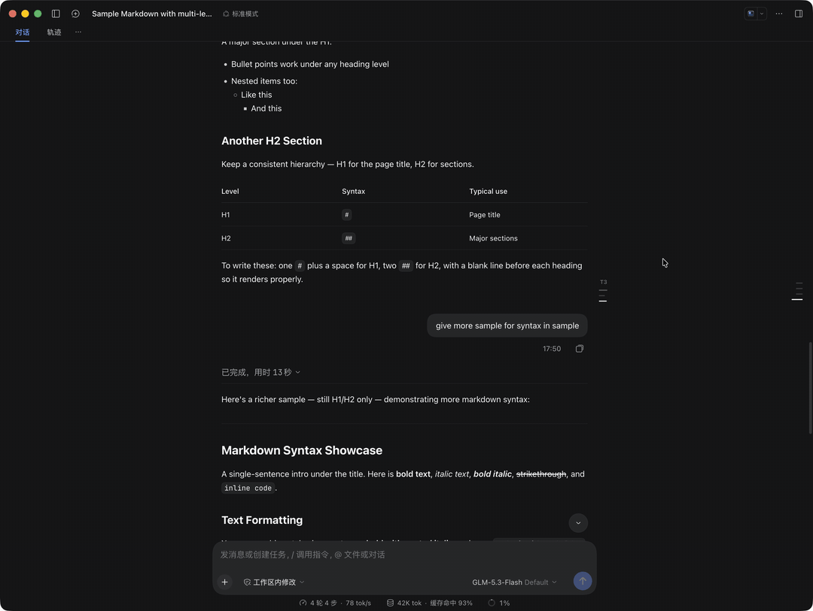

# @addozhang/dsh-turn-toc

English | [简体中文](./README.zh-CN.md)

Turn section outline (TOC) plugin for the **DeepSeek Harness** Web & Desktop GUI.

It sits in the right gutter just outside the centered message column—sharing the frameless tick-mark aesthetic of DSH's built-in `TurnNavigator`—and expands on hover into an interactive multi-level heading outline for the turn you are currently reading.



## Features

- **Frameless Tick Marks at Rest**: Renders subtle horizontal tick bars graded by heading level (`H1`–`H6`) right beside the message column, keeping your visual focus on the right without covering any text or colliding with the outer `TurnNavigator`.
- **Dual Scroll Spy (Turn + Heading)**: Automatically tracks which Turn is at the viewport reading line and highlights the active section (`H1`–`H6`) as you scroll.
- **Hover to Expand & Pin**: Smoothly expands into a translucent `MenuSurface` outline card on pointer hover, with a pin toggle to keep the outline open when desired.
- **1-Click Section Jump**: Click any heading row (or click a tick mark directly without expanding) to smoothly scroll to that section with a brief highlight flash.
- **Quick Turn Flipping**: Header buttons let you jump to the top of the current Turn (`Turn N`) or step directly to the previous (`↑`) / next (`↓`) Turn.
- **Responsive Auto-Hide**: Appears only when the conversation container (`>= 1280px`) and right gutter (`>= 176px`) have enough room to expand strictly to the right without overlapping the message column or the outer `TurnNavigator`.

## Installation

### From npm

```sh
dsh plugin --profile web add @addozhang/dsh-turn-toc
```

### From GitHub

```sh
dsh plugin --profile web add github:addozhang/dsh-turn-toc
```

Restart the running `dsh` profile (or the DeepSeek Harness Desktop app) after installation so the browser roster picks up the client bundle.

## Development

```sh
npm install
npm run build      # bundle lib/client.js and lib/index.js
npm run watch      # watch src/client/ for live HMR reload
npm test           # run unit tests (outline parser + DOM scroll-spy & jump)
```

## License

[MIT](./LICENSE)
