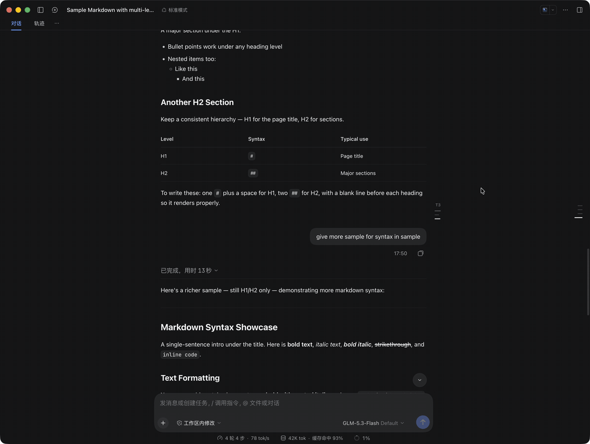

# @addozhang/dsh-turn-toc

[English](./README.md) | 简体中文

专为 **DeepSeek Harness** Web 与 Desktop GUI 打造的轮次内章节目录（Turn TOC）插件。

它位于居中正文列的右侧留白处，采用与 DSH 原生 `TurnNavigator` 完全一致的无框极简刻度尺设计语言：平时仅展示按标题层级长短递减的水平短横线，鼠标移入（Hover）时向右展开为可交互的多级章节大纲卡片。



## 核心特性

- **原生级无框刻度尺（平时零遮挡）**：静默状态下仅在正文列右缘外侧 `16px` 处展示代表 `H1`–`H6` 层级的水平短横线，既让视线保持在右侧，又绝不遮挡正文或干扰最右侧的 `TurnNavigator`。
- **双重滚动跟随（Turn 级 + 小节 Heading 级）**：随鼠标滚轮自动识别当前阅读的轮次（Turn），并实时高亮当前正在阅读的具体章节（即使子标题折叠也会自动高亮父级）。
- **悬停展开 + 图钉常驻（Hover & Pin）**：鼠标滑过刻度线即向右丝滑展开毛玻璃目录卡，移出自动收起；点击右上角图钉按钮可固定常驻展开。
- **一键点击直达**：点击目录中的任意章节（或直接在收起态点击某根短横线），页面即平滑滚动定位到对应标题并伴随柔和背景闪烁提示。
- **跨轮次快捷翻阅**：目录头部内置 `第 N 轮`（点击回到本轮开头）以及 `↑ 上一轮` / `↓ 下一轮` 按钮，鼠标无需移开即可连续翻阅不同 Turn。
- **严格向右展开与窄屏自适应隐退**：仅在对话容器宽度 `>= 1280px` 且右侧净留白 `>= 176px` 时显示，确保展开卡片严格向右伸展，绝不向左挤压正文或向右触碰 `TurnNavigator`。

## 安装

### 通过 npm 安装

```sh
dsh plugin --profile web add @addozhang/dsh-turn-toc
```

### 通过 GitHub 安装

```sh
dsh plugin --profile web add github:addozhang/dsh-turn-toc
```

安装完成后重启对应的 `dsh` profile（或重启 DeepSeek Harness 桌面端应用）即可生效。

## 本地开发

```sh
npm install
npm run build      # 构建 lib/client.js 与 lib/index.js
npm run watch      # 监听客户端源码变动，配合 DSH HMR 实时热更新
npm test           # 运行单元测试（Markdown 标题解析 + DOM 定位与滚动跟随）
```

## 开源协议

[MIT](./LICENSE)
