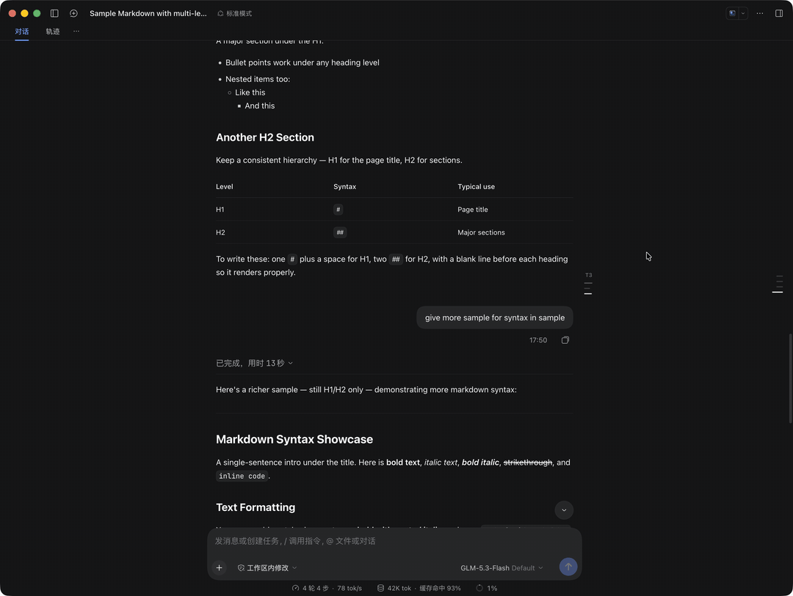

# Turn Outline · Turn TOC

A frameless tick-mark ruler in the right gutter beside the message column, sharing the exact aesthetic of DSH's built-in `TurnNavigator`: at rest just a few horizontal ticks graded by heading level; on hover it expands into an interactive multi-level heading outline — 1-click jumps, previous/next Turn flipping, and scroll-spy highlighting, all without leaving your reading position.

**If it works for you, please [star the repo](https://github.com/addozhang/dsh-turn-toc)** — that directly decides how fast this plugin evolves.

## Highlights

- **Zero footprint at rest** — just `H1`–`H6` graded tick marks; never covers text, never collides with the outer `TurnNavigator`
- **Dual scroll spy** — Turn-level plus heading-level: the section you are reading highlights live as you scroll, parents highlight even when children are collapsed
- **Hover to expand & pin** — a translucent outline card slides open on hover and closes on leave; pin it to keep it open
- **1-click jump** — click an outline row or a tick mark directly for a smooth scroll with a soft highlight flash
- **Quick Turn flipping** — `Turn N` / `↑` / `↓` header buttons step between Turns without moving the mouse
- **Responsive auto-hide** — hidden entirely under `1280px` container width or insufficient gutter; never squeezes the message column

## Quick start

1. Install: `dsh plugin --profile <profile> add @addozhang/dsh-turn-toc`
2. Restart that profile (or the DeepSeek Harness desktop app) — done

## Compatibility

dsh ≥ 0.2.0-rc.1 and < 0.3.0 (works on both Web and Desktop GUI).

## Links

- Source & docs: <https://github.com/addozhang/dsh-turn-toc>
- Issues: <https://github.com/addozhang/dsh-turn-toc/issues>
- npm package: <https://www.npmjs.com/package/@addozhang/dsh-turn-toc>

---

Finding it useful? [Leave a Star](https://github.com/addozhang/dsh-turn-toc/stargazers) so I know it helped 🙌
