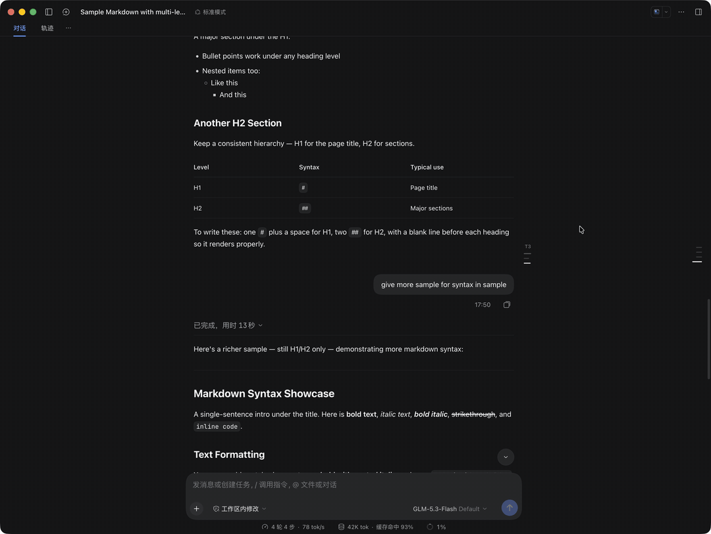

# 轮次章节目录 · Turn TOC

在正文列右侧留白处放一把与 DSH 原生 `TurnNavigator` 同风格的无框刻度尺：平时只有几根按标题层级长短递减的短横线，鼠标移入即展开为可交互的多级章节大纲——一键跳转、上下轮翻阅、滚动跟随高亮，全都不用离开阅读位置。

**好用的话，欢迎去 [GitHub 仓库](https://github.com/addozhang/dsh-turn-toc) 点个 ⭐ Star**——这直接决定这个插件的迭代速度。

## 亮点

- **平时零遮挡** — 静默时只有 `H1`–`H6` 层级短横线，不盖正文、不碰 `TurnNavigator`
- **双重滚动跟随** — Turn 级 + 小节级：滚动时实时高亮当前阅读章节，子标题折叠也会高亮父级
- **悬停展开 + 图钉常驻** — 滑过即展开毛玻璃目录卡，移出收起；图钉可固定常驻
- **一键直达** — 点目录行或直接点短横线，平滑滚动 + 背景闪烁提示
- **跨轮翻阅** — 头部 `第 N 轮` / `↑` / `↓` 按钮，连续翻 Turn 不挪鼠标
- **窄屏自动隐退** — 容器 `< 1280px` 或留白不足时整体隐藏，绝不挤压正文

## 快速开始

1. 安装：`dsh plugin --profile <profile> add @addozhang/dsh-turn-toc`
2. 重启对应 profile（或重启 DeepSeek Harness 桌面端）即可生效

## 兼容性

dsh ≥ 0.2.0-rc.1 且 < 0.3.0（Web 与 Desktop GUI 通用）。

## 链接

- 源码与文档：<https://github.com/addozhang/dsh-turn-toc>
- 问题反馈：<https://github.com/addozhang/dsh-turn-toc/issues>
- npm 包：<https://www.npmjs.com/package/@addozhang/dsh-turn-toc>

---

喜欢这个插件？[点个 Star](https://github.com/addozhang/dsh-turn-toc/stargazers) 让我知道它帮到了你 🙌
